<div align="center">

# 🩺 컴퓨터가 알아서 자기 상태를 점검하게 만들기

### SSH 보안 · UFW 방화벽 · 역할 기반 권한(ACL) · Bash 모니터링 · cron 자동화


</div>

> 장애가 났을 때 '감'이 아니라 '기록'으로 원인을 찾을 수 있도록, 서버가 스스로 상태를 점검하고 남기게 만든다.

**미션**: B4-1 · 컴퓨터가 알아서 자기 상태를 점검하게 만들기 (Linux와 OS · 40h)

## 프로젝트 개요

리눅스 서버를 "접속 가능한 상태"에서 "운영 가능한 상태"로 끌어올리는 미션입니다. 접속 경로(SSH 포트·root 차단, 방화벽)를 좁히고, 역할별 계정·그룹·ACL로 "공유 디렉터리"와 "보안 디렉터리"를 분리한 뒤, 제공된 에이전트 앱을 일반 계정으로 띄워 `monitor.sh`가 1분마다 프로세스·포트·자원을 점검하고 한 줄 로그로 남기게 했습니다.

설계 방향은 세 가지입니다. **(1) 최소 권한**: 필요한 계정에게 필요한 만큼만 연다. **(2) 재현성**: 환경 변수와 cron 환경을 코드로 고정해 누가 어디서 실행해도 같은 결과가 나온다. **(3) 사후 추적성**: 로그는 `grep`/`awk`로 바로 집계되는 고정 포맷 한 줄로 남기고, 로그가 디스크를 먹지 않도록 상한을 둔다.

## 주요 기능

| 영역 | 내용 | 구현 위치 |
|---|---|---|
| 기본 보안 | SSH 포트 `20022`, `PermitRootLogin no` | `/etc/ssh/sshd_config` |
| 방화벽 | UFW 활성화, 인바운드 `20022/tcp`, `15034/tcp`만 허용 | `ufw` |
| 계정/그룹 | `agent-admin`·`agent-dev`·`agent-test`, `agent-common`·`agent-core` | `setup_server.sh` |
| 권한/ACL | 공유(`upload_files`) / 보안(`api_keys`, 로그) 디렉터리 분리 | `setup_server.sh` |
| 헬스체크 | 앱 프로세스 + TCP 15034 LISTEN 확인, 실패 시 `exit 1` | `bin/monitor.sh` |
| 자원 수집 | CPU / MEM / DISK(`/`) 사용률 + 임계값(20/10/80%) 경고 | `bin/monitor.sh` |
| 로그 | `/var/log/agent-app/monitor.log` 누적, 10MB × 10개 상한 | `bin/monitor.sh` |
| 자동 실행 | `agent-admin` crontab, 매분 실행 | `setup_server.sh` |
| 보너스 1 | 로그 구간 통계 리포트 (평균/최대/최소/샘플 수) | `bin/report.sh` |
| 보너스 2 | 7일 경과 압축·이동, 30일 경과 삭제, 예외 안전 종료 | `bin/log_retention.sh` |

## 개발 환경

- 언어/런타임: Bash (자동화 스크립트는 Bash만 사용, Python 등으로 대체하지 않음)
- 운영체제: Ubuntu Server 22.04.5 LTS — VirtualBox VM (Windows 호스트, NAT + 포트 포워딩, 호스트 PowerShell에서 `ssh`/`scp`로 접속)
- 주요 도구: `ufw`, `openssh-server`, `cron`, `acl`(`setfacl`), `iproute2`(`ss`), `awk`, `flock`
- 외부 라이브러리: 없음 (기본 유틸리티만 사용)
- 실행 방식: 일반 계정(`agent-admin`)으로 앱·cron 실행, `sudo`는 설정 단계에서만 사용

## 배포 & 실행 방법

- GitHub 저장소: https://github.com/segretoo/codyssey-b4-1

```bash
git clone https://github.com/segretoo/codyssey-b4-1.git && cd codyssey-b4-1

# 1) SSH 포트/root 차단 + 2) 방화벽  → 접속이 끊길 수 있어 아래 "설정 / 명령어 기록"의 1·2번을 순서대로 수동 진행
# 3) 계정·그룹·디렉터리·권한·ACL·키 파일·환경 변수·스크립트 배포·cron 등록 (idempotent)
sudo ./setup_server.sh

# 4) 앱 실행 (agent-admin, 별도 터미널/tmux) → 기록 6번 참고
# 5) 1~2분 뒤 로그 누적 확인
sudo tail -n 5 /var/log/agent-app/monitor.log
```

## 설정 / 명령어 기록

### 1. SSH 포트 변경 + root 원격 로그인 차단

```bash
sudo cp /etc/ssh/sshd_config /etc/ssh/sshd_config.bak     # 롤백용 백업
sudo sed -i -E 's/^#?Port .*/Port 20022/; s/^#?PermitRootLogin .*/PermitRootLogin no/' /etc/ssh/sshd_config
sudo sshd -t                                              # 문법 검사 (출력 없으면 정상)
sudo systemctl restart ssh                                # 기존 세션은 유지된 채 재시작됨
```

```bash
# 확인 (증거 캡처 대상)
grep -E '^(Port|PermitRootLogin)' /etc/ssh/sshd_config
sudo sshd -T | grep -Ei '^(port|permitrootlogin) '        # 실제 적용값 (conf.d 덮어쓰기까지 확인)
sudo ss -tulnp | grep sshd                                # 20022 LISTEN 확인
# 새 터미널에서: ssh -p 20022 <계정>@<서버IP> 성공, root 계정은 거부되어야 함
```

> 기존 SSH 세션은 새 포트 접속이 성공할 때까지 닫지 않습니다. 실패 시 `sshd_config.bak`으로 복구합니다.

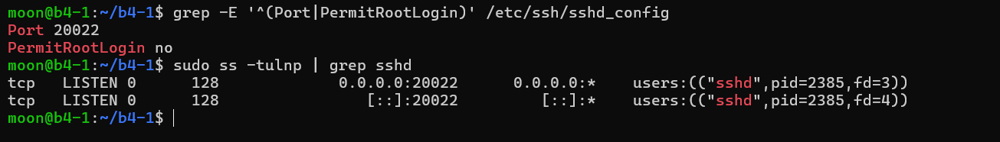

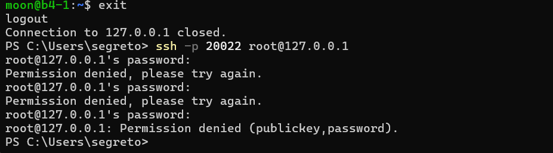

### 2. 방화벽 (UFW)

```bash
sudo apt install -y ufw
sudo ufw default deny incoming
sudo ufw default allow outgoing
sudo ufw allow 20022/tcp comment 'SSH'      # enable 하기 전에 먼저 허용 (자기 자신 잠금 방지)
sudo ufw allow 15034/tcp comment 'agent-app'
sudo ufw enable
sudo ufw status verbose                     # Status: active + 20022/tcp, 15034/tcp 만 보여야 함
```

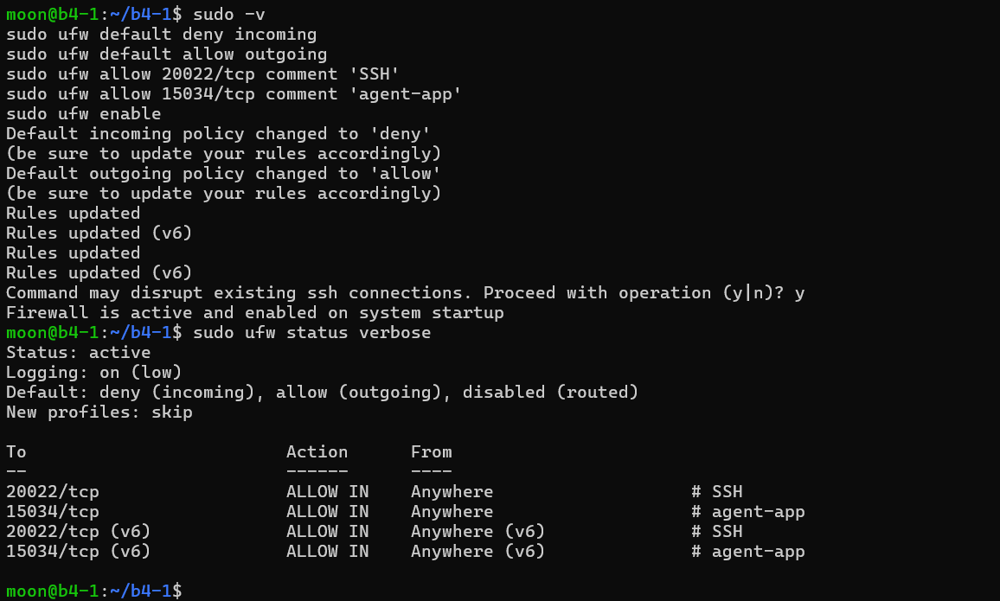

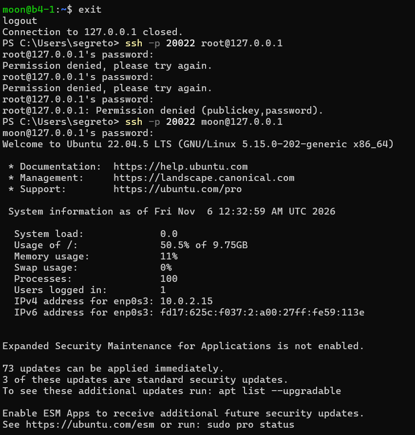

### 3. 계정 / 그룹

```bash
sudo groupadd agent-common && sudo groupadd agent-core
for u in agent-admin agent-dev agent-test; do sudo adduser --disabled-password --gecos "" "$u"; done
sudo usermod -aG agent-common,agent-core agent-admin   # 운영/관리, cron 실행자
sudo usermod -aG agent-common,agent-core agent-dev     # 개발/운영, monitor.sh 작성자
sudo usermod -aG agent-common            agent-test    # QA/테스트 (core 제외)
id agent-admin; id agent-dev; id agent-test            # 증거 캡처 대상
```

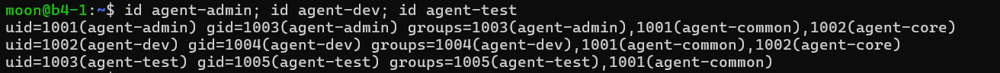

### 4. 디렉터리 구조 / 권한 / ACL

| 경로 | 소유자:그룹 | 모드 | 의도 |
|---|---|---|---|
| `$AGENT_HOME` (`/home/agent-admin/agent-app`) | `agent-admin:agent-core` | `750` + ACL | 앱 루트 |
| `$AGENT_HOME/upload_files` | `agent-admin:agent-common` | `2770` | 3개 계정 모두 R/W (공유) |
| `$AGENT_HOME/api_keys` | `agent-admin:agent-core` | `2770` | `agent-core`만 R/W (보안) |
| `$AGENT_HOME/bin/monitor.sh` | `agent-dev:agent-core` | `750` | 작성자 `dev`, 실행은 `core`(cron의 `admin`) |
| `/var/log/agent-app` | `agent-admin:agent-core` | `2770` | `agent-core`만 R/W (보안) |

```bash
# 경로 통과용 ACL: 홈(750) 때문에 dev/test 가 upload_files 까지 못 들어가는 문제를 '통과(x)'만 열어 해결
sudo setfacl -m  g:agent-common:--x /home/agent-admin
sudo setfacl -m  g:agent-common:r-x /home/agent-admin/agent-app
sudo setfacl -m  g:agent-common:rwx /home/agent-admin/agent-app/upload_files
sudo setfacl -d -m g:agent-common:rwx /home/agent-admin/agent-app/upload_files   # 앞으로 생길 파일에도 상속
getfacl /home/agent-admin/agent-app/upload_files; ls -l /home/agent-admin/agent-app   # 증거 캡처 대상
```

(디렉터리 생성·`chown`·`chmod`·ACL 전체는 `setup_server.sh`의 2번 단계에 들어 있습니다.)

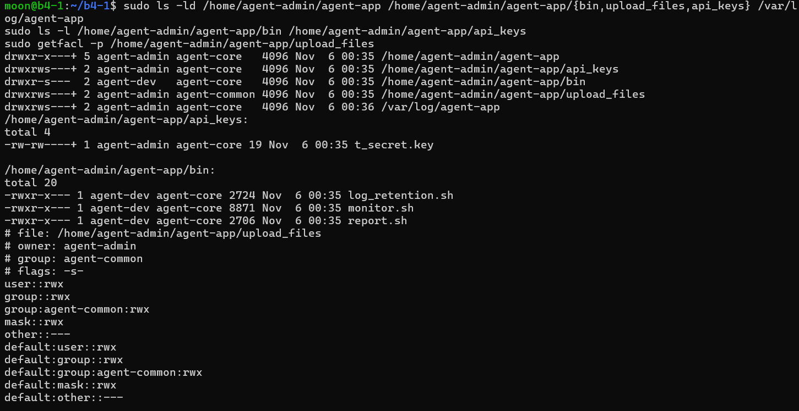

`agent-test`는 공유 폴더에 쓸 수 있고, 보안 폴더의 키는 읽을 수 없습니다(`agent-dev`는 읽기 가능).

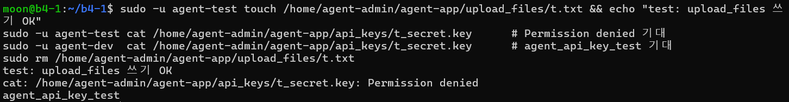

### 5. 환경 변수 + 키 파일

```bash
# agent-admin 의 ~/.bashrc 에 등록 (setup_server.sh 가 자동 추가)
export AGENT_HOME=/home/agent-admin/agent-app
export AGENT_PORT=15034
export AGENT_UPLOAD_DIR=$AGENT_HOME/upload_files
export AGENT_KEY_PATH=$AGENT_HOME/api_keys      # 미션 문서는 .../t_secret.key 지만 제공 앱은 '폴더' 경로를 기대함 (트러블슈팅 참고)
export AGENT_LOG_DIR=/var/log/agent-app

printf '%s\n' "agent_api_key_test" > "$AGENT_HOME/api_keys/t_secret.key"   # 내용 1줄 (문서 기준 파일명)
chown agent-admin:agent-core "$AGENT_HOME/api_keys/t_secret.key"; chmod 660 "$AGENT_HOME/api_keys/t_secret.key"
cp -p "$AGENT_HOME/api_keys/t_secret.key" "$AGENT_HOME/api_keys/secret.key"   # 제공 앱이 찾는 파일명
```

### 6. 앱 실행 (일반 계정)

```bash
uname -m                                  # x86_64 → agent-app-linux-x86 / aarch64 → agent-app-linux-arm64
# agent-app.zip 에서 아키텍처에 맞는 파일 하나만 꺼내 AGENT_HOME 에 배치 (zip 안의 __MACOSX/ 는 Mac 찌꺼기라 무시)
sudo unzip -j ~/agent-app.zip agent-app-linux-x86 -d /home/agent-admin/agent-app/
sudo chown agent-admin:agent-core /home/agent-admin/agent-app/agent-app-linux-x86
sudo chmod 750 /home/agent-admin/agent-app/agent-app-linux-x86

sudo -iu agent-admin                      # root 가 아닌 agent-admin 으로 전환 (이 줄은 혼자 실행: 여러 줄 붙여넣기 금지)
printenv | grep ^AGENT_                   # 환경 변수 확인
cd "$AGENT_HOME" && ./agent-app-linux-x86 # Boot Sequence 5단계 OK + Agent READY 확인, 종료는 Ctrl+C
ss -tulnp | grep 15034                    # 0.0.0.0:15034 LISTEN 확인 (다른 터미널)
```

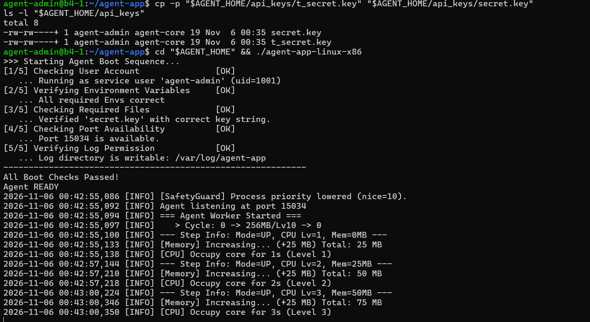

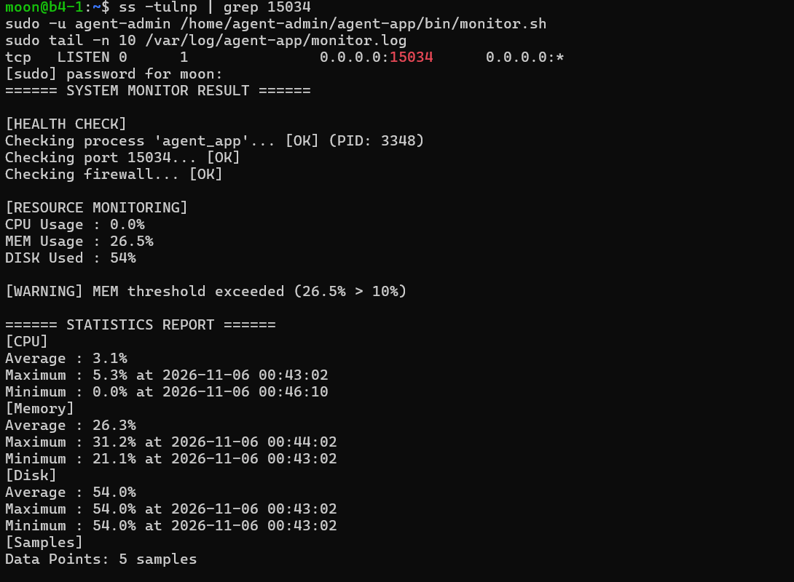

### 7. monitor.sh 수동 실행 + cron 등록

```bash
ls -l "$AGENT_HOME/bin/monitor.sh"        # -rwxr-x--- agent-dev agent-core
sudo -u agent-admin "$AGENT_HOME/bin/monitor.sh"      # 콘솔 결과 (프로세스/포트/자원/경고/통계)
tail -n 5 /var/log/agent-app/monitor.log
```

CPU 경고를 확인하려고 `yes > /dev/null` 두 개로 일부러 부하를 걸고 실행한 화면입니다(프로세스·포트·방화벽 OK, CPU/MEM 경고, 통계).

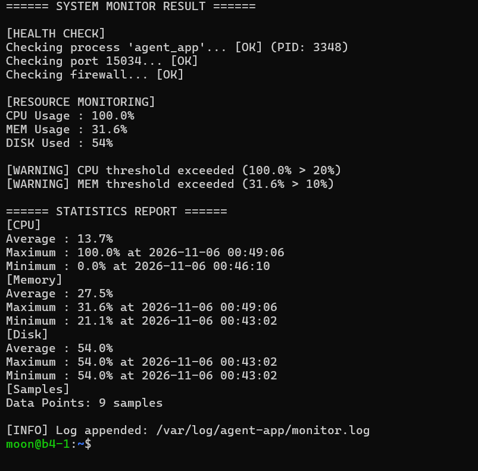

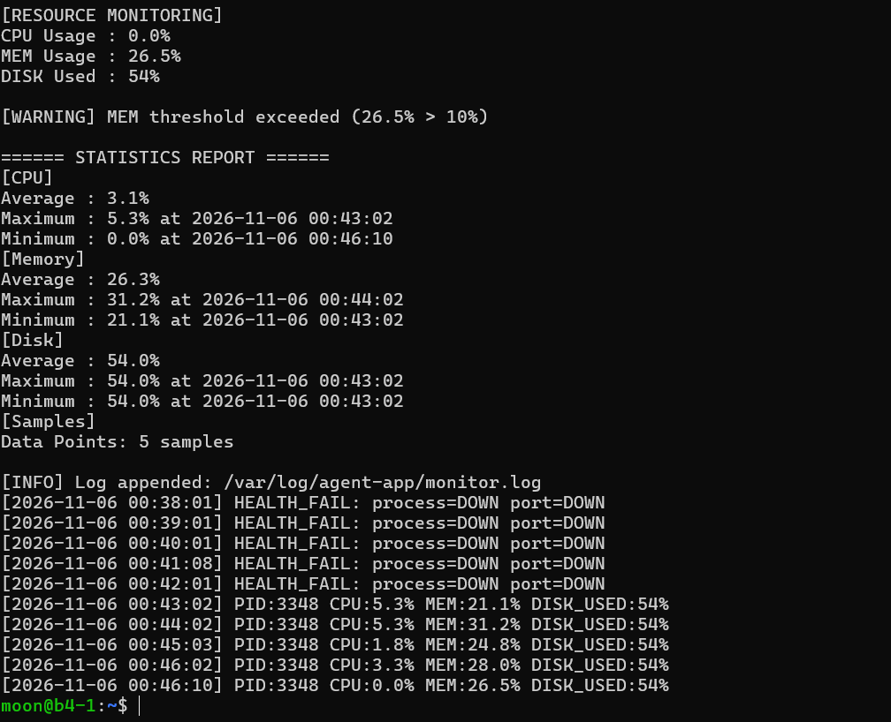

앱이 꺼진 상태에서 실행하면 헬스체크가 실패하고 종료 코드 `1`로 끝납니다.

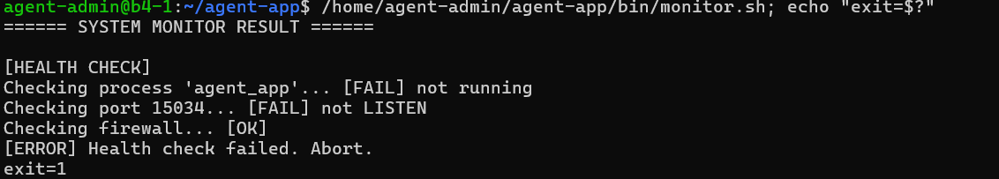

로그가 크기 한도에 도달하면 `monitor.log`가 `monitor.log.1`로 밀려나고 새 `monitor.log`가 시작됩니다(로테이션 동작 확인용으로 한도를 낮춰 실행).

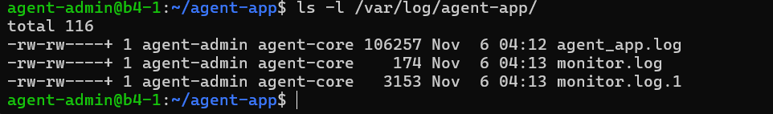

```cron
# sudo -u agent-admin crontab -e  (setup_server.sh 가 동일 내용을 자동 등록)
SHELL=/bin/bash
PATH=/usr/local/sbin:/usr/local/bin:/usr/sbin:/usr/bin:/sbin:/bin
AGENT_HOME=/home/agent-admin/agent-app
AGENT_PORT=15034
AGENT_LOG_DIR=/var/log/agent-app
* * * * * /home/agent-admin/agent-app/bin/monitor.sh >/dev/null 2>&1
```

```bash
sudo -u agent-admin crontab -l            # 등록 확인
sudo systemctl status cron --no-pager     # cron 서비스 active (running)
wc -l /var/log/agent-app/monitor.log; sleep 70; wc -l /var/log/agent-app/monitor.log   # 줄 수 증가 = 자동 실행 증거
```

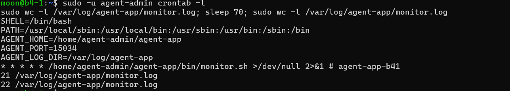

### 8. 보너스

**보너스 1 — `report.sh` (전체 / 구간 통계)**

```bash
sudo -u agent-admin /home/agent-admin/agent-app/bin/report.sh
sudo -u agent-admin /home/agent-admin/agent-app/bin/report.sh "2026-11-06 00:43" "2026-11-06 00:46"
```

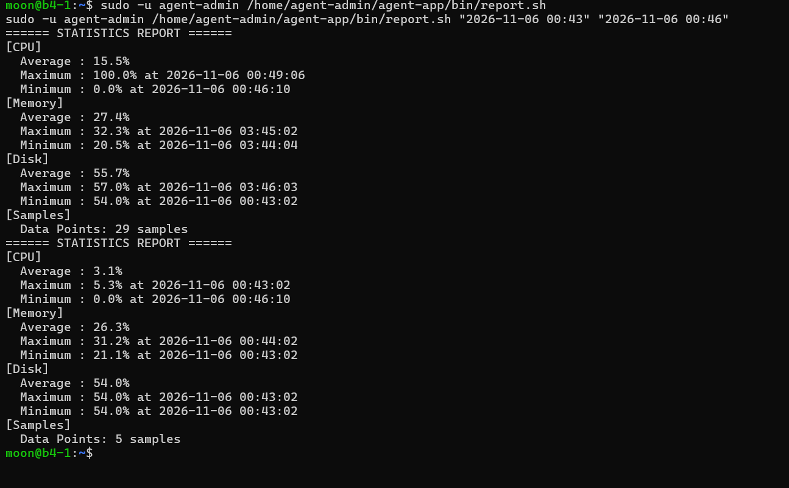

**보너스 2 — `log_retention.sh` (7일 압축·이동, 30일 삭제, 예외 처리)**

```bash
# 시연용 파일: 10일 전 .log, 40일 전 .gz, 10일 전 .gz
sudo -u agent-admin sh -c 'echo "old log" > /var/log/agent-app/demo_old.log; touch -d "10 days ago" /var/log/agent-app/demo_old.log'
sudo -u agent-admin sh -c 'echo x | gzip > /var/log/monitor/agent-app/archive/demo_very_old.gz; touch -d "40 days ago" /var/log/monitor/agent-app/archive/demo_very_old.gz'
sudo -u agent-admin sh -c 'echo x | gzip > /var/log/monitor/agent-app/archive/demo_recent.gz; touch -d "10 days ago" /var/log/monitor/agent-app/archive/demo_recent.gz'

sudo -u agent-admin env DRY_RUN=1 /home/agent-admin/agent-app/bin/log_retention.sh      # 대상만 확인 (변경 없음)
sudo -u agent-admin /home/agent-admin/agent-app/bin/log_retention.sh                    # 실제 실행
sudo -u agent-admin env ARCHIVE_DIR=/nonexistent /home/agent-admin/agent-app/bin/log_retention.sh; echo "exit=$?"   # 예외: 경고 + exit 0
```

| 대상 | 결과 |
|---|---|
| `demo_old.log` (10일 경과) | 압축되어 `archive/demo_old.log.20261106.gz`로 이동, 원본 삭제 |
| `demo_very_old.gz` (40일 경과) | 삭제 |
| `demo_recent.gz` (10일 경과) | 유지 |
| `monitor.log`, `agent_app.log` (최신) | 유지 |

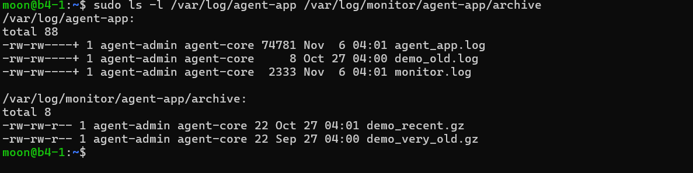

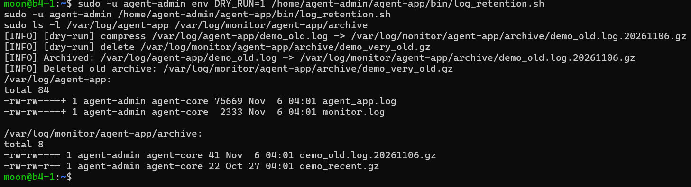

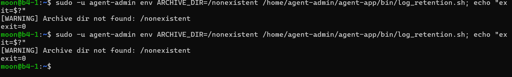

상시 운영 시에는 crontab에 `10 3 * * * /home/agent-admin/agent-app/bin/log_retention.sh >/dev/null 2>&1`(매일 03:10)을 추가합니다.

## 필수 증거 자료 체크리스트

캡처 파일은 `evidence/` 폴더에 있습니다.

| # | 증거 | 확인 명령 | 캡처 파일 | 상태 |
|---|---|---|---|---|
| 1 | SSH 포트 20022 + root 원격 접속 차단 | `grep`, `ss -tulnp`, `ssh root@...` | [01-ssh](evidence/01-ssh.png), [01b-root-denied](evidence/01b-root-denied.png) | ✅ |
| 2 | 방화벽 활성 + 20022/15034만 허용 | `ufw status verbose` | [02-ufw](evidence/02-ufw.png), [02b-ssh-after-ufw](evidence/02b-ssh-after-ufw.png) | ✅ |
| 3 | 계정/그룹 생성 | `id agent-admin / agent-dev / agent-test` | [03-accounts](evidence/03-accounts.png) | ✅ |
| 4 | 디렉터리 구조·권한·ACL | `ls -l`, `getfacl` | [04-perms](evidence/04-perms.png), [04b-perms-test](evidence/04b-perms-test.png) | ✅ |
| 5 | 앱 Boot Sequence 5단계 `[OK]` + `Agent READY` | 앱 실행 화면, `ss -tulnp` | [05-boot](evidence/05-boot.png), [05b-port-listen](evidence/05b-port-listen.png) | ✅ |
| 6 | monitor.sh 실행 결과 + 비정상 시 `exit 1` | `monitor.sh; echo "exit=$?"` | [06-monitor](evidence/06-monitor.png), [06b-exit1](evidence/06b-exit1.png) | ✅ |
| 7 | monitor.log 누적 기록 + 용량 로테이션 | `tail -n 10 monitor.log`, `ls -l /var/log/agent-app/` | [07-log](evidence/07-log.png), [07b-rotation](evidence/07b-rotation.png) | ✅ |
| 8 | crontab 등록 + 1분 뒤 로그 증가 | `crontab -l`, `wc -l` 전후 비교 | [08-cron](evidence/08-cron.png) | ✅ |
| 보너스 1 | report.sh 전체·구간 통계 | `report.sh` | [09-bonus-report](evidence/09-bonus-report.png) | ✅ |
| 보너스 2 | 7일 압축·이동, 30일 삭제, 예외 처리 | `log_retention.sh` | [10a](evidence/10a-bonus-retention-before.png), [10b](evidence/10b-bonus-retention-run.png), [10c](evidence/10c-bonus-retention-exception.png) | ✅ |

## 프로젝트 구조

```
codyssey-b4-1/
├── README.md              # 수행 내역서 (이 문서)
├── setup_server.sh        # 계정·권한·ACL·키·환경 변수·배포·cron 일괄 구성
├── bin/
│   ├── monitor.sh         # 상태 점검 + 로그 누적 (필수 제출물)
│   ├── report.sh          # 로그 통계 리포트 (보너스 1)
│   └── log_retention.sh   # 압축/아카이브/삭제 (보너스 2)
└── evidence/              # 증거 캡처 이미지
```

- `setup_server.sh`: SSH 포트·방화벽은 접속이 끊길 수 있어 일부러 제외했고, 나머지는 여러 번 실행해도 결과가 같게(idempotent) 작성
- `bin/`: 서버에서는 `$AGENT_HOME/bin/`으로 배포되어 `agent-dev:agent-core`, `750` 권한을 가짐

## 학습 목표 & 설명

**Q. SSH 포트 변경과 Root 원격 접속 차단이 왜 기본 보안인가요?**
**"공격 표면을 줄이고, 가장 흔한 공격 대상(22번 포트·root 계정)의 직행 경로를 없애는 것"**입니다.

- `22/tcp`는 자동 스캐너가 가장 먼저 두드리는 포트라, 옮기면 무차별 대입 시도와 로그 노이즈가 크게 줄어듭니다
- `root`는 계정명이 모두에게 알려져 있어 비밀번호만 맞히면 끝나므로 `PermitRootLogin no`로 막습니다
- 일반 계정으로 접속한 뒤 `sudo`로 올라가면 **누가 언제 권한을 썼는지**가 로그에 남습니다
- 한계: 포트 변경은 숨기는 수준이라 근본 대책이 아닙니다. 다음 단계는 키 인증과 `PasswordAuthentication no`입니다

**Q. UFW로 "필요한 포트만 허용"하는 정책은 어떻게 구성하고 검증했나요?**
**"기본 거부(`default deny incoming`) 후 필요한 포트만 예외로 여는 화이트리스트"**로 구성했습니다.

- `deny incoming` + `allow 20022/tcp` + `allow 15034/tcp` 순서로 설정하고, 허용 규칙을 먼저 넣은 뒤 `ufw enable` 합니다 (자기 자신 잠금 방지)
- 검증은 `ufw status verbose`로 규칙을 보고, 외부에서 `nc -zv <IP> 20022` 같은 포트 테스트로 열린/닫힌 포트를 직접 확인합니다
- 클라우드 VM이면 방화벽이 한 겹 더 있습니다 (보안 목록/NSG). 거기도 같은 포트를 열어야 합니다

**Q. 역할 기반 계정/그룹/ACL로 "공유 디렉터리"와 "보안 디렉터리"를 분리하는 이유는?**
**"협업에 필요한 곳은 열고, 비밀이 있는 곳은 필요한 역할에게만 닫아 두기 위해서"**입니다.

- `agent-common`(admin·dev·test) → `upload_files` 공유, `agent-core`(admin·dev) → `api_keys`와 로그
- QA 계정 `agent-test`는 키와 운영 로그를 볼 이유가 없으므로 `agent-core`에서 제외 → 유출 경로가 줄어듭니다
- `2770`의 setgid로 새 파일이 부모 그룹을 물려받아, 누가 만들어도 팀 그룹으로 관리됩니다
- 홈 디렉터리(`750`) 때문에 dev/test가 경로를 못 지나가는 문제는 `chmod o+x`로 모두에게 열지 않고, **ACL로 `agent-common`에게 통과(`x`)만** 열어 해결했습니다

**Q. 환경 변수(`AGENT_HOME` 등)로 실행 환경을 고정하는 이유와 검증 방법은?**
**"실행하는 계정·위치·셸이 달라도 같은 경로와 설정을 쓰게 만들어 결과를 재현하기 위해서"**입니다.

- 앱과 스크립트가 `AGENT_HOME`, `AGENT_KEY_PATH`, `AGENT_LOG_DIR` 기준으로 파일을 찾으므로, 미지정 시 기본값 때문에 엉뚱한 경로나 권한 오류가 납니다
- cron은 로그인 셸이 아니라 `~/.bashrc`를 읽지 않으므로 crontab 상단에 `PATH`와 `AGENT_*`를 직접 선언합니다
- 검증: `printenv | grep ^AGENT_`, 앱 Boot Sequence 2/5 `[OK]`, cron 실행으로 로그가 정상 누적되는지 확인

**Q. 쉘 스크립트로 프로세스/포트/자원을 수집하고 로그로 남겨 문제를 추적하는 흐름은?**
**"수집 → 고정 포맷 한 줄 기록 → 이상 시점 사후 탐색"** 3단계입니다.

- 수집: 프로세스(PID), TCP 15034 LISTEN, CPU(`/proc/stat` 1초 간격 차이), MEM(`MemAvailable` 기준), DISK(`/` 사용률)
- 기록: `[YYYY-MM-DD HH:MM:SS] PID:.. CPU:..% MEM:..% DISK_USED:..%` 한 줄 → `grep`/`awk`로 바로 집계 가능
- 추적 예: `grep HEALTH_FAIL monitor.log`로 처음 죽은 시각을 찾고, 그 직전 줄들의 CPU/MEM 추이를 본다
- 헬스체크 실패는 `exit 1`, 임계값 초과와 방화벽 비활성은 경고만 출력하고 계속 진행합니다

**Q. crontab으로 주기 실행하고 로그 보존 정책(압축/삭제)이 왜 필요한가요?**
**"사람이 보지 않는 시간에도 기록을 남기되, 그 기록이 디스크를 채우지 않게 하기 위해서"**입니다.

- 매분 1줄(약 60~65B)이면 하루 1,440줄 ≈ 90KB입니다. 작아 보여도 몇 달 누적되고, 같은 디렉터리의 앱 로그도 함께 쌓입니다
- 로그가 디스크를 채우면 모니터링 대상인 서비스 자체가 죽습니다 (감시자가 장애 원인이 되는 상황)
- `monitor.sh`는 10MB가 넘으면 `.1 ~ .9`로 밀어내 **최대 10개 파일**만 유지하고, 보너스로 7일 경과 압축 · 30일 경과 삭제까지 구현했습니다

## 설계 Trade-off

| 결정 | 선택 | 이유 |
|---|---|---|
| 프로세스 탐지 | `pgrep -f`(명령줄 전체) 대신 **실행 파일/스크립트 이름만** 비교 | 명령줄 전체를 보면 `vim agent_app.py`, 경로에 `agent-app`이 든 `monitor.sh` 자신까지 "앱이 살아있다"고 오판합니다. 실제로 앱을 꺼도 `OK`가 나오는 오탐을 겪었고, `pgrep -x`는 프로세스 이름이 15자로 잘려 `agent-app-linux-x86`(19자)와 맞지 않아 쓰지 못했습니다 |
| 로그 로테이션 | `logrotate` 대신 **스크립트 내 구현** (`rotate_log()`) | ① `logrotate` 설정(`/etc/logrotate.d/`)은 root 권한이 필요한데 cron 실행 계정은 일반 계정(`agent-admin`)입니다 ② 기본 `logrotate`는 하루 한 번 실행되어, 매분 쌓이는 로그가 10MB를 넘는 시점에 바로 자르지 못합니다 ③ 스크립트 하나에 점검·기록·로테이션이 들어 있어 제출물만으로 동작이 완결됩니다 |
| 방화벽 점검 | `ufw status`(root 필요) 대신 `ufw.conf` + 서비스 상태 | 일반 계정에서 매분 실행 가능. 한계: 허용 포트 목록까지는 점검하지 못함 |
| 헬스체크 실패 | `exit 1` + 로그에 `HEALTH_FAIL` 한 줄 | 비정상 종료도 흔적이 남아야 사후 추적 가능 (통계는 샘플 형식 줄만 집계) |
| 동시 실행 | `flock`으로 겹침 방지 | 이전 실행이 길어져도 로그가 뒤섞이거나 로테이션이 꼬이지 않음 |
| cron 출력 | `>/dev/null 2>&1` | 출력은 이미 `monitor.log`에 남기므로 cron 메일/별도 파일 누적 방지 |
| 로그 기록 방식 | 덮어쓰기 `>` 대신 **이어쓰기 `>>`** | `>`는 열 때마다 파일을 비웁니다. cron이 매분 새 프로세스로 실행하므로 `>`를 쓰면 로그에 **마지막 한 줄만** 남아 추이를 볼 수 없습니다. `>>`는 기존 내용 뒤에 붙이므로 누적됩니다 (키 파일처럼 항상 새로 만드는 파일에는 `>`를 씁니다) |

**참고: 운영 환경에서 `logrotate`를 쓴다면** (root 권한 + 하루 1회 → 시간 단위 실행이 필요해 `logrotate.timer` 주기 조정 또는 별도 cron이 필요)

```conf
# /etc/logrotate.d/agent-app
/var/log/agent-app/monitor.log {
    size 10M            # 10MB 이상이면 회전
    rotate 9            # 현재 파일 + 이전 9개 = 최대 10개
    missingok
    notifempty
    create 660 agent-admin agent-core
}
```

## 배운 것 & 마무리

> 이 프로젝트를 통해 답할 수 있게 된 질문: **"서버가 아무도 보지 않는 시간에 이상해졌을 때, 무엇을 근거로 원인을 찾을 것인가?"**

**보안** — SSH 포트/root 차단, 기본 거부 방화벽, 최소 권한 / **권한 설계** — 사용자·그룹·setgid·ACL, `chmod` 모드 해석 / **쉘 스크립트** — `/proc` 파싱, `awk` 집계, `flock`, 종료 코드, 안전한 예외 처리 / **운영 자동화** — cron 환경(`PATH`, 변수), 로그 로테이션과 보존 정책 / **관측성** — 고정 포맷 로그, 임계값 경고, 통계 리포트

## 참고 / 트러블슈팅

- **접속 잠금 주의**: 새 포트(20022)로 접속이 성공하기 전에 기존 세션을 닫지 않습니다. 순서는 SSH 설정 → UFW 허용 → UFW enable → 새 터미널 접속 테스트입니다
- **VirtualBox 포트 포워딩**: NAT 환경이라 호스트에서 VM으로 들어가려면 규칙이 필요합니다 (`2222→22` 초기 접속, `20022→20022` SSH 변경 후, `15034→15034` 앱). SSH 포트를 바꾸면 `2222→22`는 더 이상 쓰이지 않으므로 이후 접속·전송은 `-p 20022` / `-P 20022`를 씁니다
- **기존 서비스 충돌**: 방화벽을 20022/15034만 허용하면 같은 서버의 웹 서비스(80/443)는 막힙니다. 다른 미션의 배포 서버와 분리된 VM에서 진행하는 것이 안전합니다
- **미션 문서와 제공 앱의 기대값 불일치 (Boot Sequence로 발견)**: 문서대로 `AGENT_KEY_PATH=$AGENT_HOME/api_keys/t_secret.key`로 설정했더니 `[2/5]`가 `Key Path Mismatch. Expected: .../api_keys`로 실패했습니다 (앱은 **폴더** 경로를 기대). 고친 뒤 `[3/5]`가 `Missing File: secret.key`로 실패해서 **`secret.key`**도 만들었습니다 (문서의 `t_secret.key`는 그대로 유지). 앞 단계가 실패하면 뒤 단계는 `Skipped due to previous critical failure`로 건너뛰므로, 실패 메시지의 `Expected` 값을 그대로 따라가면 됩니다
- **여러 줄 붙여넣기 주의**: `sudo -iu`, `ssh`처럼 셸이 바뀌는 명령 뒤에 붙인 줄은 새 셸이 열리기 전에 입력돼 사라집니다. 첫 `sudo`가 비밀번호를 물을 때도 뒤 줄이 비밀번호로 들어갈 수 있어 `sudo -v`를 먼저 실행하고 붙여넣습니다
- **Ubuntu 24.04**: `ssh.socket`이 포트를 잡고 있어 `sshd_config`의 `Port`가 무시될 수 있습니다. 이 경우 `sudo systemctl disable --now ssh.socket && sudo systemctl enable --now ssh`로 서비스 방식으로 전환합니다
- **앱 파일**: 제공 앱은 아키텍처별로 파일이 다릅니다(x86 / arm64). `uname -m`으로 확인해서 맞는 파일을 실행합니다
- **프로세스는 있는데 포트가 안 열릴 때** (`HEALTH_FAIL: process=OK port=DOWN`): ① `ss -ltnp | grep 15034` 또는 `sudo lsof -i :15034`로 누가 어느 주소(`127.0.0.1`만인지, 전체인지)에 열었는지 확인 ② 앱 로그(`/var/log/agent-app/agent_app.log`)와 stderr에서 **바인딩 오류**를 찾습니다 — `Address already in use`(다른 프로세스가 같은 포트 점유), `Permission denied`(1024 미만 포트는 root 필요), 설정된 `AGENT_PORT` 불일치 ③ `ps -o pid,stat,etime,cmd -p <PID>`로 아직 기동 중인지, 재시작을 반복하는지 확인 ④ 서버 안(`nc -zv 127.0.0.1 15034`)에서는 열리는데 밖에서만 안 되면 UFW/VirtualBox 포트 포워딩 문제입니다
- **로그가 급증해 디스크가 찰 때**: ① `df -h`, `du -xh /var/log --max-depth=2 | sort -h`로 큰 파일 확인 ② 열려 있는 로그는 `rm`해도 공간이 돌아오지 않으므로 `truncate -s 0` 또는 프로세스 재시작 ③ `COMPRESS_DAYS=1 log_retention.sh`로 보존 기간을 줄여 압축·이동 ④ 급증 원인(오류 반복, 디버그 레벨)을 먼저 차단 ⑤ `DISK_LIMIT`(기본 80%) 경고가 뜨는지 `monitor.sh` 출력으로 확인. 장기적으로는 `/var/log` 별도 볼륨, 중앙 로그 수집을 고려합니다
- **웹 서버(Nginx 등)로 감시 대상이 바뀔 때**: `AGENT_PROC_REGEX='^nginx'`, `AGENT_PORT=80`으로 대상만 바꿀 수 있고, 로그 경로와 `CPU_LIMIT`/`MEM_LIMIT`은 환경 변수로 조정합니다. 웹 서버는 포트가 열려도 정상 응답이 아닐 수 있어 `curl`로 HTTP 응답 확인을, 동시 접속·리스닝 큐(`ss -s`, `worker_connections`) 점검은 별도로 추가해야 합니다
- **cron이 안 돌 때**: ① `systemctl status cron` ② 스크립트 실행 권한/그룹(`agent-admin`이 `agent-core` 소속인지) ③ 로그 디렉터리 쓰기 권한 ④ `/var/log/syslog`의 `CRON` 줄 순서로 확인합니다
